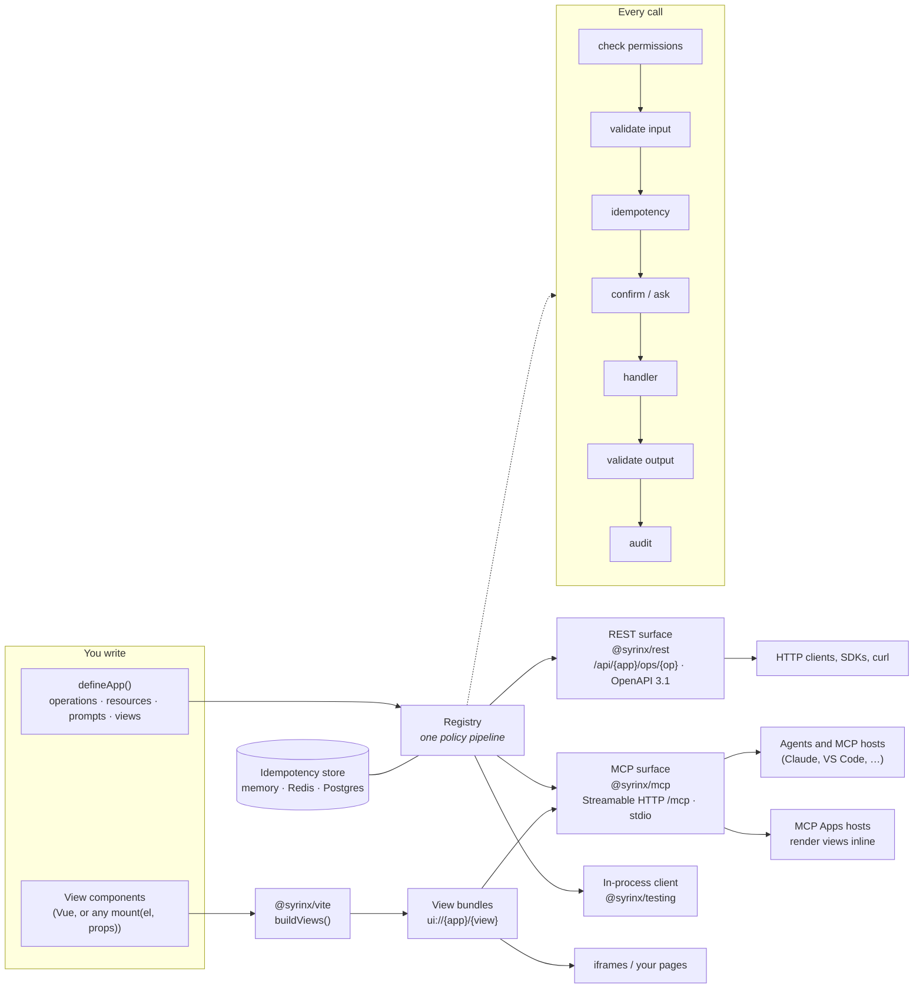

# Syrinx

Declare an app once (typed operations, resources, prompts and views) and Syrinx serves it as a spec-compliant MCP server, a standard REST API with OpenAPI 3.1, and static UI for MCP Apps hosts, iframes and your own pages.

> **Status:** pre-release. Nothing is published to npm yet, and the production hardening in Phase 4 is still landing, so
> do not run it in production. See [Roadmap](#roadmap).

## Why Syrinx

Most services now need two front doors: an HTTP API for programs and people, and an MCP server for AI agents. Built separately, they drift. Validation differs, one surface checks permissions the other forgets, error shapes disagree, and the docs describe neither accurately. Syrinx makes the app definition the single source of truth and generates every surface from it.

- **Write the logic once.** An operation is a schema in, a schema out, and a handler. Syrinx turns it into a REST endpoint, an MCP tool and an OpenAPI path, with the same JSON Schema behind each.
- **Same behavior everywhere.** Every call, whatever surface it arrives on, runs through one pipeline: permission checks, input validation, idempotency, confirmation, the handler, output validation, audit. A rule you add applies to agents and HTTP clients alike. `@syrinx/testing` checks this: `checkParity` runs a call in-process, over REST and over MCP and reports any difference.
- **Agents that ask before they act.** An operation can ask the caller to confirm (`confirm`) or for more input (`ctx.ask`) partway through. MCP clients see an elicitation; REST clients get an `input_required` result and resume with the answers. The pending state is sealed and signed, so the server stays stateless and a caller cannot tamper with it.
- **UI that travels with the tools.** A view is a small Vue (or any framework) component bound to an operation's results. MCP Apps hosts render it inline in the chat; the same bundle works in an iframe or on your own page.
- **Standards, not lock-in.** Schemas use [Standard Schema](https://standardschema.dev) (Zod, Valibot, ArkType). The REST surface uses problem+json errors and OpenAPI 3.1; the MCP surface uses the official TypeScript SDK and runs the official conformance suite. It runs on Node, Bun and Deno, standalone or inside NestJS.
- **Safe defaults.** Writes can be retried with an `Idempotency-Key` and replay their first outcome. Tools are scoped by permission and hidden from callers who cannot use them. The MCP surface only accepts localhost hosts until you configure it.

## How it works



1. **Define.** `defineApp` collects an app's members. An _operation_ is an action with typed input and output, annotations (read-only, destructive, asks) and permissions. A _resource_ is addressable data under a URI template. A _prompt_ is a reusable message template. A _view_ is a UI component bound to operations.
2. **Register.** `createRegistry([...apps])` validates the definitions, converts schemas to JSON Schema, lints for common mistakes and owns the shared pipeline and stores. The registry does not know about HTTP or MCP.
3. **Serve.** Each surface is a thin adapter that maps its protocol onto the registry. `createRestApp` turns operations into `POST /api/{app}/ops/{op}` with a uniform envelope, resources into `GET` routes, and the whole catalog into an OpenAPI document. `createMcpSurface` turns operations into tools, resources into MCP resources, prompts into MCP prompts and views into `ui://` resources. Both are plain `fetch` handlers, so they mount on Hono, NestJS or anything that speaks Web `Request`/`Response`.
4. **Call.** A request arrives on any surface, is converted to the same `invoke`, and runs through the same pipeline under the caller's principal. The result is converted back into the surface's native shape: an envelope or problem+json for REST, a tool result or protocol error for MCP.

Because the surfaces only translate, adding one (or a new transport) does not touch your app code, and a fix to the pipeline applies to all of them.

## Example

```ts
import { createRegistry, defineApp, op } from "@syrinx/core";
import { createMcpSurface } from "@syrinx/mcp";
import { createRestApp } from "@syrinx/rest";
import { z } from "zod";

const invoices = defineApp({
  name: "invoices",
  version: "1.0.0",
  description: "Look up customer invoices.",
  operations: {
    get: op({
      description: "Fetch one invoice by id.",
      input: z.object({ id: z.string() }),
      output: z.object({ id: z.string(), totalCents: z.number() }),
      annotations: { readOnly: true },
      handler: ({ id }) => ({ id, totalCents: 1200 }),
    }),
  },
});

const registry = createRegistry([invoices]);
const app = createRestApp({ registry });
// POST /api/invoices/ops/get {"id":"inv_1"}
// -> {"resultType":"complete","data":{"id":"inv_1","totalCents":1200},"meta":{"requestId":"…"}}

const mcp = createMcpSurface({ registry, name: "invoices", version: "1.0.0" });
app.all("/mcp", (c) => mcp.fetch(c.req.raw));
app.all("/mcp/*", (c) => mcp.fetch(c.req.raw));
// MCP tools/call invoices_get {"id":"inv_1"} on /mcp, or get on /mcp/invoices

export default app;
```

`examples/invoices` is a fuller app with permissions, confirmations, resources, prompts, views and parity tests.

### Views

A view renders an operation's results inside MCP Apps hosts. Declare it on the app; write it in Vue (or any framework that implements `mount(el, props)`):

```ts
views: {
  browser: view({
    entry: new URL("./views/InvoiceBrowser.vue", import.meta.url), // built by @syrinx/vite, never loaded by the server
    boundTo: ["list", { op: "get", component: "detail" }], // these tools render this view; `get` shows one part
    calls: ["send"], // operations the view may call (app visibility)
    embeds: [customers.views.badge], // another app's view, rendered inline with <Embed>
  }),
},
```

Build the bundles with `buildViews({ apps, outDir, plugins: [vue()] })`, load them with `loadViewShells({ dir })` from `@syrinx/ui/server`, and pass them to `createMcpSurface({ views })`. Bound tools then carry `_meta.ui.resourceUri`, views are served as `ui://{app}/{view}` resources, and operations only views call are listed with `_meta.ui.visibility: ["app"]`. Only MCP Apps hosts honor that visibility: other hosts show app-only tools to the model like any other tool, so give them the same permissions you would give a model-visible tool. Shells inline their bundle by default; pass `baseUrl` to reference hosted, SRI-pinned files served by `serveViewAssets` instead. Views speak the MCP Apps protocol through a small built-in channel rather than the ext-apps SDK, so a Vue view is about 30 KB gzipped, and the MCP surface gzips responses (set `compress: false` when a proxy already does).

Parts of one view share typed state with `defineViewContext` and `<ViewContext>`/`useViewContext`, including views embedded from other apps.

Operations a view calls can still confirm or ask (`confirm`, `ctx.ask`). Hosts only show those questions during a chat turn (VS Code rejects them otherwise, and strips `_meta` from view calls), so Vue views call operations through an app-only `syrinx_view_call` tool: questions come back to the view as data, a default dialog shows them, and the answers return as arguments with the sealed `requestState`. Each call must carry the view token from the view's shell, which is sealed to the view and its caller and never appears in tool results, so a model that can see the tool still cannot answer the view's questions for the user. The tool only reaches operations that view calls or is bound to, and it refuses clients that declare capabilities without MCP Apps. Views without a token (no `requestStateKey`, or an expired token) call tools directly, and the host does the asking. `toView(Component, { prompt: false })` lets a view draw its own dialog from `useView().value.prompt`.

## Deploying

The MCP surface accepts localhost Host and Origin headers only by default; set `allowedHosts` (and `allowedOrigins` for browser callers) when you deploy.

Operations that confirm or ask seal their state with `requestStateKey`, which defaults to `SYRINX_REQUEST_STATE_KEY` (at least 32 bytes; several keys, comma-separated and newest first, rotate without breaking pending questions). Hosts built on `resolveRequestStateKey`, such as `@syrinx/nest`, refuse to start without one under `NODE_ENV=production` and use a development key otherwise.

Writes sent with an `Idempotency-Key` replay their first outcome. The default store keeps keys in memory, so it only deduplicates within one process (the registry warns about that under `NODE_ENV=production`). With more than one instance, pass a shared store; pass `idempotency: false` to stop deduplicating and drop the header from OpenAPI:

```ts
import { createRedisIdempotencyStore } from "@syrinx/redis";
import { createClient } from "redis"; // or ioredis

const redis = await createClient({ url: process.env.REDIS_URL }).connect();
const registry = createRegistry(apps, { idempotency: createRedisIdempotencyStore(redis) });
```

`createPostgresIdempotencyStore(pool)` from `@syrinx/postgres` does the same on a node-postgres pool; call its `migrate()` once to create the table. Every store keeps outcomes for 24 hours (`ttlMs`) and frees a claim whose request never finished after 5 minutes (`inFlightTtlMs`; set it above your slowest write). Each claim carries a token, so a request that outlives its claim cannot overwrite or free the claim of the request that took the key over. If recording an outcome fails, the caller still gets the result and the key stays claimed, so a retry gets a 409 instead of running the write twice. The memory store holds at most 100,000 keys (`maxEntries`). `describeIdempotencyStore` from `@syrinx/testing/stores` is the contract they pass, for writing your own store.

## Packages

| Package                       | Contents                                                                                            | Status     |
| ----------------------------- | --------------------------------------------------------------------------------------------------- | ---------- |
| `@syrinx/core`                | `defineApp`, `op`, `resource`, `prompt`, JSON Schema conversion, policy pipeline, input round trips | Phases 1–2 |
| `@syrinx/rest`                | REST surface on Hono: catalog, manifests, envelope, problem+json, resources, OpenAPI 3.1            | Phase 1    |
| `@syrinx/testing`             | In-process, REST and MCP clients, parity checks                                                     | Phases 1–2 |
| `@syrinx/mcp`                 | MCP surface on the TypeScript SDK v2: Streamable HTTP at `/mcp` and `/mcp/{app}`, stdio             | Phase 2    |
| `@syrinx/ui`                  | View contract, host bridges (MCP Apps, preview), view context; `/server` renders and serves shells  | Phase 3    |
| `@syrinx/ui-vue`              | Vue binding: `toView`, `useView`, `useAppView`, `ViewContext`, `Embed`, `ViewPart`                  | Phase 3    |
| `@syrinx/nest`                | NestJS module: REST, MCP and built views beside Nest's routes; operations reach Nest providers      | Phase 3    |
| `@syrinx/vite`                | `buildViews`: one self-contained bundle per view, `manifest.json`, gallery page                     | Phase 3    |
| `@syrinx/redis`               | Idempotency store on your node-redis or ioredis client                                              | Phase 4    |
| `@syrinx/postgres`            | Idempotency store on your node-postgres or postgres.js client, with `migrate` and `prune`           | Phase 4    |
| `@syrinx/host`, `@syrinx/cli` | Host, CLI                                                                                           | Phases 4–5 |

## Development

Requires Node 20+ and pnpm 10.

```sh
pnpm install
pnpm typecheck
pnpm lint      # ESLint with typed typescript-eslint rules
pnpm format    # Prettier; CI runs format:check
pnpm test
pnpm build
pnpm smoke   # runtime smoke test; CI also runs it under Bun and Deno
pnpm lint:openapi   # Spectral on the example's generated OpenAPI (Node 22+)
pnpm conformance    # official MCP conformance suite against examples/conformance (start it first)
pnpm --filter @syrinx/example-invoices size:views   # bytes per package in each view bundle
pnpm test:stores    # store contract against real Redis and Postgres (set REDIS_URL and DATABASE_URL)
pnpm test:e2e       # views in headless Chromium behind a real MCP Apps host page (run `pnpm exec playwright install chromium` once)
```

Run the example app with `pnpm --filter @syrinx/example-invoices start` (after `pnpm build`; add `build:views` first to serve its views), then try `curl -H "Authorization: Bearer reader" localhost:3000/api/invoices/ops/list`, or point an MCP client at `http://localhost:3000/mcp` with the same bearer token.

To see the views in VS Code, run `pnpm --filter @syrinx/example-invoices build:views`, then start the `syrinx-invoices` server from `.vscode/mcp.json` (stdio) and ask Copilot to list invoices. The gallery at `examples/invoices/dist/views/gallery.html` shows every view example at two widths without a host.

`examples/conformance` holds the fixtures the official MCP conformance suite calls. Start it with `pnpm --filter @syrinx/example-conformance start`, then run `pnpm conformance`; `examples/conformance/expected-failures.yaml` lists the required scenarios Syrinx does not pass yet, and why.

`pnpm install` also sets up a pre-commit hook that runs ESLint and Prettier on staged files. Set `SKIP_SIMPLE_GIT_HOOKS=1` to bypass it.

Record changes to published packages with `pnpm changeset`.

## Roadmap

Phases 1–3 of 5 are done; Phase 4 is in progress. Phase 4's production hardening (secret handling, pluggable idempotency stores, rate limiting, loopback by default) has not fully landed.

| Phase                                                                           | Status      |
| ------------------------------------------------------------------------------- | ----------- |
| 1 · Core + REST                                                                 | Done        |
| 2 · MCP                                                                         | Done        |
| 3 · UI (views over MCP Apps, Vue binding, view builds)                          | Done        |
| 4 · Compose + secure + persist (hardening, auth, multi-tenancy, Postgres/Redis) | In progress |
| 5 · Embed channel, CLI, docs site, 0.1 release                                  | Planned     |

## License

[Apache-2.0](LICENSE)
